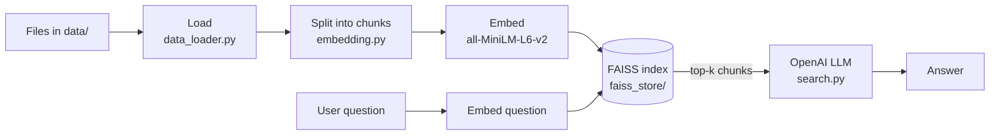

# RAG Document Q&A

Ask questions in plain English and get answers grounded in your own documents.

This project is a **Retrieval-Augmented Generation (RAG)** pipeline in Python. It loads your files, splits them into chunks, embeds them, and indexes them with FAISS. For each question, it retrieves the most relevant passages and has an OpenAI model answer from those passages only.

## How it works



1. **Load:** reads every supported file in `data/` into LangChain `Document` objects.
2. **Split:** breaks documents into 1,000-character chunks with 200 characters of overlap, so passages that cross a chunk boundary aren't lost.
3. **Embed:** converts each chunk into a 384-dimension vector with Sentence-Transformers (`all-MiniLM-L6-v2`).
4. **Store:** indexes the vectors in FAISS and saves the index to disk, so later runs reload it instead of re-embedding everything.
5. **Retrieve:** embeds the question with the same model and finds the closest chunks.
6. **Generate:** sends the question and the retrieved chunks to an OpenAI model, which writes the answer.

## Supported file types

PDF, TXT, CSV, Excel (`.xlsx`), Word (`.docx`) and JSON.

## Project structure

```
RAG/
├── app.py                # Entry point: runs a sample question
├── src/
│   ├── data_loader.py    # Loads all supported files from data/
│   ├── embedding.py      # Chunking and embedding pipeline
│   ├── vectorstore.py    # FAISS index: build, save, load, query
│   └── search.py         # Retrieval + LLM answer (RAGSearch)
├── notebook/
│   ├── document.ipynb    # Document loaders walkthrough
│   └── pdf_loader.ipynb  # Full prototype with ChromaDB, sources and confidence scores
├── data/
│   ├── pdf/              # Your PDFs
│   └── text_files/       # Your text files
├── faiss_store/          # Saved FAISS index (created automatically)
├── pyproject.toml
└── uv.lock
```

## Getting started

### 1. Requirements

- Python 3.12+
- [uv](https://docs.astral.sh/uv/)
- An OpenAI API key

### 2. Install

```bash
git clone https://github.com/Safaazaoui/RAG.git
cd RAG
uv sync
```

### 3. Add your API key

Create a `.env` file in the project root:

```
OPENAI_API_KEY=your-key-here
OPENAI_MODEL=your-model-id
```

`.env` is listed in `.gitignore`. Never commit it.

### 4. Add documents

Put your files in `data/` (any subfolder works).

### 5. Run

```bash
uv run app.py
```

The first run builds the FAISS index in `faiss_store/`. Later runs load the saved index.

To change the question, edit `query` in `app.py`.

> **Added new documents?** Delete the `faiss_store/` folder and run again to rebuild the index.

## Using it in your own code

```python
from src.search import RAGSearch

rag = RAGSearch()
answer = rag.search_and_summarize("What is Prolog?", top_k=3)
print(answer)
```

## Tech stack

| Layer | Tool |
|---|---|
| Orchestration | LangChain |
| Document loading | PyPDF, PyMuPDF, LangChain community loaders |
| Embeddings | Sentence-Transformers (`all-MiniLM-L6-v2`) |
| Vector search | FAISS (app), ChromaDB (notebook prototype) |
| LLM | OpenAI API via `langchain-openai` |
| Environment | uv, python-dotenv |

## Roadmap

- [ ] Show sources (file name and page) with each answer
- [ ] Hybrid search: BM25 keyword search + vector search, merged with Reciprocal Rank Fusion
- [ ] Retrieval evaluation set to measure answer quality
- [ ] FastAPI endpoint and Streamlit interface
- [ ] Docker setup

## Author

Safaa Zaoui: Computer Science (Co-op), Toronto Metropolitan University
